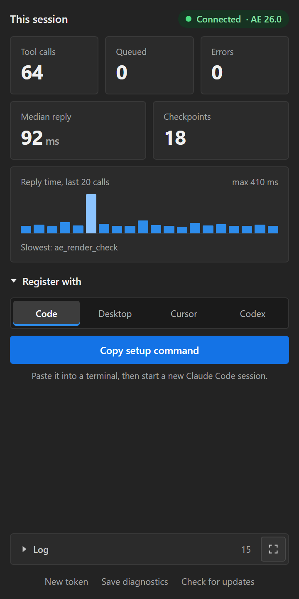
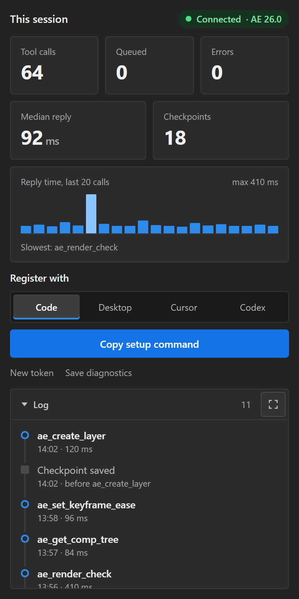
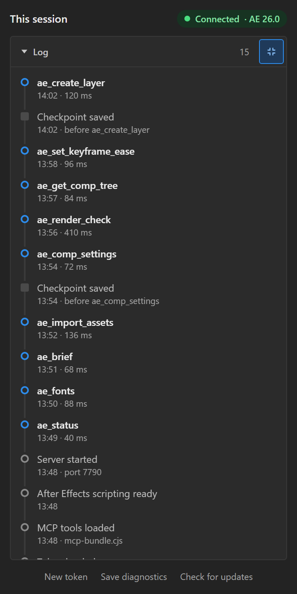
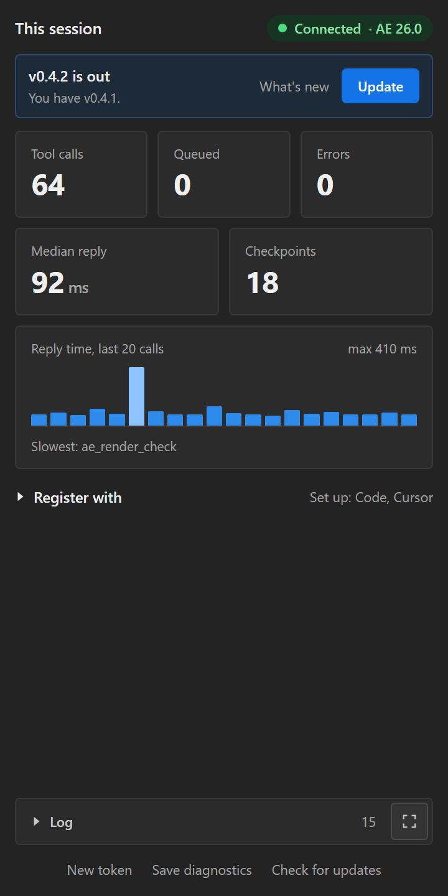

# chroma-ae-mcp

<table>
  <tr>
    <td align="center"><br><sub>Log closed</sub></td>
    <td align="center"><br><sub>Log open</sub></td>
    <td align="center"><br><sub>Log filling the panel</sub></td>
  </tr>
</table>

An MCP server that lets Claude Code, Claude Desktop, Cursor and Codex drive **Adobe After Effects 2026** (AE 26.x, CEP 12) safely, alongside a person who is editing live. It runs **inside After Effects** and starts with it, so there is no separate server to install or run.

This is an internal Chroma tool, not a consumer product.

> **Status: v0.5.0, released 2026-11-05** (signed ZXP on the [v0.5.0 release](https://github.com/jameslashmar/chroma-ae-mcp/releases/tag/v0.5.0)). The panel updates itself from GitHub releases (see [Updates](#updates)); 0.4.0 has to be updated by hand once.
> - **173 tools.** On top of 0.4.1's 80: three waves of 69 more (layer ops, captions, rigs, render batches, delivery checks and so on), then wave 4 (18 compositing tools: planar tracking, stabilizing, removing things from a shot, patch fitting and checks, screen replacement) and wave 5 (6 new tools and many extensions of existing ones, from an audit of the AE Scripting Guide). All of it passes the build, 4531 unit tests (102 files) and the ExtendScript lint, its host code runs against a simulated AE DOM, and the bundle runs on AE's Node 17.7.2. Every wave went through multi-agent code reviews with fix rounds (106 findings in the first, 123 in wave 4, 65 in wave 5, and others). **Live smoke** (`qa/smoke-mcp.mjs`, AE 26.2.1 on Windows, a generated scratch project): 519 of 526 checks passed, 17 skipped; the bugs the first runs found are fixed. Not run on macOS, and it doesn't judge visual quality or use real footage. **The 7 failures are all aerender jobs that never start rendering** (cause not proven; see `docs/HANDOVER.md`): jobs now fail cleanly after 3 attempts, and `ae_render_batch` runs one aerender at a time. On PRISM (AE 26.3) aerender started every time but often left its engine idle after exiting, which blocked the next job; the server now ends that engine 10 s after aerender exits. Whether that was the cause is not yet confirmed. `docs/HANDOVER.md` lists the AE behaviours the tools rely on.
> - The 80 tools up to 0.4.1: the 55 from 0.3 were live-tested on AE 26.2.1 (Windows) and the panel has been opened in AE 26.3.
> - CI runs the build, the unit tests, the ExtendScript lint, and the in-panel MCP end to end on AE's own Node (17.7.2).
> - macOS should work but is untested. Popup reading on macOS is written and unit-tested, but has not been run on a Mac.

## What it can do

- **Read** the project, comps, layers, effects and keyframes, in bounded, paged calls.
- **Write** values, keyframes, expressions, text, footage and effects. Every write is guarded, one undo step, checkpointed and read back.
- **Look at motion**: render frames, tile them into contact sheets, graph a property's value and speed, and review a comp's animation the way an animator would, with ready easing fixes.
- **Produce versions**: one comp per CSV/JSON row, social reframes to 16:9, 1:1, 4:5 and 9:16, assets dropped in a folder imported into a bin, and saved recipes ("skills") for house rigs and lower thirds.
- **Track and key** inside AE: a sub-pixel point tracker and a measured green-screen key, with nothing extra installed.
- **Composite**: track a plane with 1 to 8 points, stabilize a shot, remove something from it (a freeze, clone or filled-in clean plate, tracked back), make the patch match the shot's colour and grain, check it over time, replace a screen, and let masks and mattes follow a track. All of it is measured from rendered frames. Content-Aware Fill, Roto Brush and Mocha have no scripting; `docs/HANDOVER.md` says what is used instead.
- **Look after the project**: make comps, tidy the Project panel, read and set Project Settings, find, check and replace fonts, find cuts in an edit, and hand the view back to the user (open, select, park the playhead).
- **Build** layers of every kind, precomps, track mattes (AE 23+ layer mattes), shape contents, masks and text animators, align and distribute, and set hundreds of properties in one undo step.
- **Work to sound**: render a comp's audio in the background and read its level, hits, tempo and beats; put markers or pulses on the beats; turn a transcript into VO markers.
- **Deliver**: check a render by importing it back, version shots up to the latest file on disk, build Essential Graphics templates and export MOGRTs, purge unused items, and check a comp against the brief's fonts, brand colours and safe areas.
- **Ask the user** in the panel, with buttons, pictures or ease curves they can reshape, and remember the project brief and their motion taste.
- **Render** through the render queue or `aerender` in the background, **read and answer popups**, and **save a diagnostics file** when something is stuck.

---

## Install (users)

1. **Install the ZXP.** Download `chroma-ae-mcp-<version>.zxp` from the latest release and install it with the [aescripts ZXP Installer](https://aescripts.com/learn/zxp-installer/) (or Anastasiy's). The certificate is self-signed ("Chroma AE MCP"), so expect a one-time warning.
2. **Start After Effects.** The MCP service starts by itself, invisibly, about 30 s after launch.
3. **Open Window > Extensions > Chroma AE MCP.** The panel should show **Connected** (pictured above).
4. **Set up your AI.** Under **Register with**, pick one: **Code** (Claude Code), **Desktop** (Claude Desktop), **Cursor** or **Codex**. **Copy** then puts that one's setup on the clipboard, and the line under the button says where it goes: a terminal command for Claude Code and Codex, or an entry to add inside `"mcpServers"` in the config file for Claude Desktop and Cursor. Pick the next one and copy again for each AI you use. Once an AI is set up, **Register with** twirls closed and lists what is set up; click it to open it again.
5. **Restart the client** (in Claude Code, `/mcp`). The `ae_*` tools appear.

**What you need:** Claude Code needs nothing but AE: the MCP runs on the Node built into AE's CEP. Claude Desktop, Cursor and Codex go through a small stdio relay, which needs Node 16 or later on the machine.

**The panel** shows this session's tool calls, queue, errors, median reply time and checkpoints, and a chart of the last 20 reply times. The **Log** at the bottom lists each tool call and checkpoint, and the service's own events (started, token loaded, warnings), newest first, with the raw service log inside it. Its twirl opens it below the tiles; the corner-arrows button makes it fill the panel, and clicking it again puts the tiles back. The panel remembers which you chose.

### Updates



The panel checks GitHub for a newer release when it opens, and again when you click **Check for updates** at the bottom of the panel. When there is one, a bar at the top says so:

- **What's new** opens the release notes in your browser.
- **Update** downloads the release's `.zxp` to your Downloads folder, checks it against the release's SHA256 (nothing is installed if it doesn't match), and opens it, so the ZXP installer registered for `.zxp` files (the aescripts ZXP Installer, or Anastasiy's) installs it.
- **Restart After Effects** when the installer finishes.

Coming from 0.4.0, which has no update button, install 0.4.1 by hand once.

<br clear="right">

**The token** belongs to this machine and survives restarts. **New token** in the panel replaces it, and Claude Code's user-scope `chroma-ae` entry is registered again automatically. The relay clients read the token themselves and need nothing.

### Registering by hand

**Claude Code.** **Copy setup command** in the panel gives this, to paste into a terminal:

```
claude mcp add --scope user --transport http chroma-ae http://127.0.0.1:7790/mcp --header "Authorization: Bearer <token>"
```

**Claude Desktop (Chat and Cowork), Cursor, Codex.** These can only launch a command, so they use the relay that ships with the panel. For Claude Desktop, open Settings > Developer > Edit Config, add this under `mcpServers`, then quit Claude Desktop from the tray and reopen it:

```json
"chroma-ae": {
  "command": "node",
  "args": ["<CEP extensions>/london.chroma.aemcp/tools/stdio-relay.cjs"]
}
```

- `<CEP extensions>` is `%APPDATA%\Adobe\CEP\extensions` on Windows (escape backslashes as `\\` in JSON) and `~/Library/Application Support/Adobe/CEP/extensions` on macOS.
- The relay forwards to the same `/mcp` as Claude Code, so every client shares one write queue.
- While AE is closed the tools stay listed, and calling one says to start AE.
- The panel's buttons back up each config file as `<file>.chroma-bak` before changing it.

---

## How it works

```
Claude Code ───────────HTTP /mcp (Bearer)──► london.chroma.aemcp.service   (hidden CEP extension, starts with AE)
Claude Desktop, Cursor,                       ├─ MCP endpoint (stateless JSON-RPC, no SDK: AE's Node 17 is too old for it)
Codex ──stdio──► tools/stdio-relay.cjs ───┘   ├─ single-writer queue · guard · quarantine · receipts · checkpoints
                                              ├─ questions for the user (ae_ask_user), served to the panel on /ask
                                              ├─ Node side: PNG and audio decode and analysis, aerender jobs, popups, asset watcher
                                              └─ evalScript ──► host/core.jsx + host/ext/*.jsx (ExtendScript)
                                            london.chroma.aemcp.panel   (Window > Extensions: status, log, register, questions, diagnostics)
```

**Why a thin guarded listener?** AE's ExtendScript DOM is complete, so `ae_run_jsx` can do almost anything. The typed tools exist where they add something `ae_run_jsx` cannot:
- verification (read-back, stale-frame checks, pixel checks);
- safety (guard, checkpoints, undo hygiene);
- a known AE trap, encoded once;
- large bounded reads;
- work ExtendScript can't do at all (pixel analysis, tracking, background renders).

## Safety model

- **Target guard.** Every write names the `project_path` (and `comp_id`) it expects. If AE has something else open, the write is refused before anything changes (`kind: "guard"`). A guard failure means stop and re-read the state, not retry.
- **One undo step per write.** The undo group begins and ends inside one evalScript, so one Ctrl+Z backs out a whole tool call.
- **Automatic checkpoints.** Before every write, the saved `.aep` is copied to `<projectdir>/_mcp_checkpoints/` (`..._auto-<tool>.aep`).
  - The copy is the last save: AE can't write its unsaved state to another file without retargeting the project. When AE has unsaved changes, or can't say, the write's `checkpoint` says so.
  - Writes between two saves share one copy. Unsaved projects and projects over the size limit (250 MB by default) are skipped. `ae_auto_checkpoint` turns it off or changes the limit.
  - `ae_checkpoint_revert` opens the checkpoint file itself, not a copy, so saving afterwards overwrites that checkpoint. Make a new checkpoint first if you need to keep it.
- **Receipts.** Writes return a before/after comparison, read back in a *separate* evalScript, because AE returns stale values when a read follows a write in the same script. `ae_comp_fingerprint` and `ae_comp_diff` show every changed property and keyframe.
- **Quarantine.** A write that times out has an unknown outcome. It is quarantined, and further writes are blocked until someone inspects the state and calls `ae_acknowledge`. Nothing is retried automatically.
- **Never kills AE mid-script.** Aborting an evalScript wedges the ExtendScript bridge, so calls queue and wait.
- **Read tools change nothing,** not even a comp's resolution: that would land on the user's undo stack (measured).
  - A read that has to render only the plate (`isolate_layers` on `ae_track_multi` and `ae_screen_corners`, `isolate` on `ae_cleanplate_pick`, or `hide_layers` on `ae_region_stats`, which switches the listed layers off instead) makes a temporary comp and removes it again in the same call. That is a write, so it needs `expect`, takes a checkpoint and obeys the quarantine. `ae_patch_check` always does it.
  - `ae_view` only changes what the user sees (selection, playhead, viewer options). It makes no undo step and no checkpoint, and hands back a `previous_state` to restore.
- **Not everything can be undone.** `ae_fonts` replace is not undoable with Ctrl+Z, so it refuses without a checkpoint and says so in the result. `ae_render_templates` with `action: "save"` stores a machine-wide preference that neither Ctrl+Z nor a checkpoint reverts. `ae_project_settings` takes a checkpoint first when auto checkpoints are on (the result's `checkpoint` is null if it was skipped: auto checkpoints off, an unsaved project, or a file over the size limit), because some settings may not undo.
- **Popups are never suppressed** (Jay's rule).
  - `ae_dialogs` reads AE's modal popups (title, text, buttons, screenshot) from outside AE's scripting thread, with OCR for the dialogs AE paints itself.
  - A timeout names any popup that is blocking AE.
  - `ae_dialog_respond` answers only popups our own operation caused, and refuses Save, Don't Save, Replace, Delete or Discard without an explicit instruction from the user. Every answer is logged.
- **Locked-down bridge.** It binds to localhost only. Every request needs the Bearer token, stored in a folder only the current user can read. Any request with an `Origin` header (from a browser) is rejected, and the `Host` header is checked strictly.

---

## Tools (173)

| Group | Tools |
|---|---|
| Status & control | `ae_status` (`detail: true` adds the selection, selected properties as ready-made paths, the viewer and the environment), `ae_quarantine_status`, `ae_acknowledge` |
| Read | `ae_get_project` and `ae_get_comp` (filtered and paged for big projects), `ae_get_layer_props` (`meta` says what each property accepts), `ae_get_layer_full` (opt-in meta, full text values and bounds in comp space; kinds include 3D model and parametric mesh layers), `ae_find_layers`, `ae_list_effects`, `ae_validate_expressions` (`fix` + `apply` repairs broken expressions project-wide after a checkpoint, then checks again), `ae_comp_tree` (what nests what, where a comp is used, unused comps), `ae_fonts` (fonts in use and missing ones; `search` finds installed fonts, `check` tests that fonts exist, are not substituted and have the glyphs for real text, `replace` swaps a font project-wide behind a mandatory checkpoint, dry run by default, not undoable) |
| Script | `ae_run_jsx`: a read, or a guarded write with a receipt. A safety lint runs first and refuses outside programs, file writes and deletes, dialogs, quitting, opening and closing projects, and writes in read mode, naming the tool to use instead. It is a guard rail, not a sandbox. `ae_skill_save` and `ae_skill_run` use the same lint. |
| Write | `ae_set_property` (value, keyframes or expression; path and marker values; fonts checked; expression errors in the receipt), `ae_set_keyframe_ease` (presets, explicit speed and influence, or a CSS-style `curve` shaped onto each segment; `rove_between` makes the middle keys roving; per-key interpolation, spatial tangents, continuity and auto-bezier flags, roving, label, or `keys: "selected"`), `ae_set_text` (string, style ranges, per-paragraph styles, typography such as caps, kerning, ligatures, scales, stroke order and joins, paragraph spacing and indents, box size, alignment, auto-fit and inset; fonts looked up by PostScript name or family and style, and refused when not installed), `ae_import_footage` (also as a comp, a cropped-layer comp or a whole project; a sequence `range`; placeholders), `ae_replace_footage` (also `action: "reload"` for file footage, listing items whose size or duration changed), `ae_batch_set` (values, keys, expressions, paths and markers on many layers: everything is found before anything is written, 500 ops per undo step) |
| Layers | `ae_create_layer` (solid, null, adjustment, text, shape, camera, light, footage, precomp, and on AE 26.3 parametric meshes; named, parented and placed; lights of every type; vertical text), `ae_precompose`, `ae_set_track_matte` (any layer as the matte on AE 23+; the layer above on older AE, refused otherwise), `ae_align` (to the comp, a safe area or the layers' box; or distribute) |
| Project housekeeping | `ae_create_comp` (a new comp from settings, from a footage item like New Comp from Footage, or a copy of a comp, deep with unique relinked precomps; range-checked, dry run by default for a deep copy), `ae_project_items` (Project panel tidying: create folders, move, rename with comp and footage expressions repaired, label, comment, delete, organise by kind, remove empty folders; dry run by default), `ae_project_settings` (read or set bit depth, working colour space, linear blending, expression engine, time display, frame counting, display start, GPU type; checkpointed first) |
| Shapes, masks & text | `ae_shape` (rectangle, ellipse, star, polygon or a free path, with fill and stroke; stroke caps, joins, dashes, taper and wave; fill rule; gradient fill and stroke; duplicate and move groups), `ae_mask` (rectangle, ellipse or path; mode, feather, opacity, expansion, invert, feather falloff, motion blur, colour, lock, RotoBezier; duplicate and reorder masks; animate a mask path with `ae_path_write` and `time`), `ae_text_animator` (any animator property through a range, wiggly or expression selector with its options; More Options grouping; variable font axes on AE 26; optionally a keyframed reveal) |
| Keyframes & markers | `ae_get_keyframes` (ease named per side, tangents, continuity and auto-bezier flags, roving, selected, label), `ae_remove_keyframes` (all, some, the selected keys or a range; the kept value is chosen), `ae_keyframes_transform` (shift, scale, reverse, move or copy keys, the selected ones too, keeping every attribute, snapped to frames, read back key by key), `ae_get_markers`, `ae_add_markers` (a list, or a transcript: SRT, VTT, ElevenLabs or Whisper JSON, per segment, sentence or word, a colour per speaker; `edit` changes or moves existing markers; protected regions, frame targets, cue points and parameters), `ae_remove_markers` |
| Edit detection | `ae_detect_cuts` (After Effects' Scene Edit Detection on a footage or pre-comp layer: list the cut times, add markers, split, or split and pre-compose; with a before and after of the stack and `layer(n)` expression warnings. A long clip blocks AE until the detection is done.) |
| Audio | `ae_audio_analyze` (the comp's sound rendered by aerender in the background, then level, onsets, tempo, beats and the loudest hits, all in comp time; or a WAV/AIFF by path), `ae_cue_keys` (a pulse on a property at each beat or onset) |
| Effects | `ae_add_effect`, `ae_set_effect` (also moves or duplicates effects, sets popups by label on AE 26.0+, picks an input layer and stage on AE 26.5+), `ae_remove_effect`, `ae_apply_preset` (.ffx), `ae_list_presets`. Parameters scripts can't set (Colorama's Output Cycle, the Curves curve) are listed as `settable: false`; a preset saved from AE carries them. Layer styles go in through a route nobody has probed live yet (a preset is the fallback). |
| Motion | `ae_contact_sheet` (up to 24 frames in one labelled PNG), `ae_motion_graph` (value and speed of one property, with the easing per key pair), `ae_motion_review` (linear moves, dead starts and stops, speed jolts, overshoot, keys between frames, and where layers come to rest against the frame and safe areas; most findings come with a ready `ae_set_keyframe_ease` fix in the user's preferred ease, roving the middle keys of a spatial move) |
| Frames | `ae_snapshot_frame` (rendered at full size, shrunk on the server to `scale` or `max_size`), `ae_compare_frames` (pixel diff; flags blank, black or transparent frames) |
| Tracking & keying | `ae_track_point` (a sub-pixel point tracker that writes the path to a null; within 0.04 px on a test shot), `ae_key_greenscreen` (Keylight, Key Cleaner and Spill Suppressor, then a measured check for screen left, holes, spill and recoloured subject, with ready fixes and a before/after preview) |
| Planar tracking | `ae_track_multi` (1 to 8 points followed together, forwards and backwards from a reference frame, with translation, similarity, affine or perspective solved per frame; lost points are found again and long shots are tracked in chunks you continue with `continue_track_id`; optionally on an isolated copy of the plate), `ae_track_read` (a track already in the project, from nulls, Corner Pin or CC Power Pin keys, AE Tracker points or transform keys, into the same format), `ae_track_apply` (a track as nulls, Corner Pin or CC Power Pin keys in the layer's own space, layer transform keys, or transform plus a residual pin, in one guarded undo step). Tracks are stored by `track_id`; the tools below use them. Points must lie on one plane. |
| Stabilizing | `ae_stabilize` (lock, smooth or position-only from a track, written as layer transform keys, a Transform effect or Corner Pin keys; scale-to-fill or Motion Tile edges; before and after sheets and a measured residual-motion check), `ae_stabilize_roundtrip` (builds a stabilize, fix, unstabilize rig: a padded work comp with a steady copy of the plate, put back over the original with the exact inverse motion, so only the patches are resampled; `remove` takes it out again) |
| Removing things | `ae_cleanplate_pick` (scores sampled frames for sharpness, motion, track quality, coverage and cleanliness, and proposes the reference frame and clone sources; read only unless `isolate` is on), `ae_cleanplate_setup` (builds the patch in one undo step: a freeze, a rendered still or an offset clone in a patch precomp, masked, tracked back from the reference frame, with an optional holdout matte; `needs_fix` until the hole is clean; `action: "reload"` reloads a painted still), `ae_inpaint_plate` (a clean plate made in Node, because Content-Aware Fill has no scripting API: a temporal median over tracked frames, then diffusion or patch fill for what no frame shows; written as a PNG to the plates folder, imported as a still, optionally placed in a patch or work comp) |
| Mattes | `ae_mask_follow` (a mask, existing or new, that rides a planar track in the layer's own space, feather points kept), `ae_garbage_matte` (a hidden tracked matte solid wired as the alpha or luma track matte of several layers, with feather, expansion and choke), `ae_caf_prep` (a tracked Subtract mask, expansion and work area for Content-Aware Fill, plus the exact panel steps for the one click only the user can make; `find_fill` finds the fill layer CAF generated, read only) |
| Patch fitting | `ae_patch_color_match` (keyed Levels or Exposure from the measured light drift of a tracked ring around the patch, in chunks you continue with `continue_id`, seam checked before and after), `ae_patch_grain` (Add Grain or Match Grain on an alpha-matted adjustment layer, tuned in measured rounds), `ae_patch_finish` (sit-in blur, mask feather, motion blur and layer quality). All take `dry_run`, which measures and plans without writing to the patch. |
| Patch checks | `ae_patch_check` (renders the comp and a temporary copy with the patch off at sampled frames, and reports leakage, seam, flicker, pops, drift, frozen grain, slip and sharpness, each with a verdict and the tool that fixes it, plus an A/B, difference and +2 stop sheet), `ae_region_stats` (rect, ellipse, polygon or ring regions, optionally tracked, measured over time with a graph; read only unless `hide_layers`). Both stop at a render budget (`max_renders`, `max_seconds`) and say 'sampled N of M frames'. |
| Screen replacement | `ae_screen_corners` (snaps four rough corner guesses to the real corners by edge-line intersection, rates each corner's confidence, estimates the aspect ratio, flags corners that leave the frame; read only unless `isolate_layers`), `ae_screen_replace` (from a track and the four corners: an aspect-correct insert above the plate, CC Power Pin or Corner Pin keyed with overscan, Levels and blur matched to the measured screen, optional reflections and motion blur, with a before/after sheet; hands or objects crossing the screen still need your own roto) |
| Builds | `ae_build_from_data` (a copy of a template comp per CSV or JSON row; every cell checked against the template before AE is touched; text that runs off the frame is flagged), `ae_reframe` (16:9, 1:1, 4:5, 9:16 or any size: backgrounds cover, other layers and controller nulls pin to the safe area at rest, mattes follow, a guide layer shows the safe area, and anything still outside it is listed) |
| Assets | `ae_import_assets`: files in `_assets/` next to the .aep go into an `_Assets` bin with subfolders mirrored and numbered stills as sequences; files already imported are skipped. `watch: true` imports new arrivals automatically. |
| Skills | `ae_skill_list`, `ae_skill_save`, `ae_skill_run`: `SKILL.md` plus numbered ExtendScript steps, per project (`ae-skills/` next to the .aep) or global. A working `ae_run_jsx` can be saved by its `op_id`. Steps are checked for ES3; a run is one undo group, and is always guarded and checkpointed when given `expect`. |
| Ask & context | `ae_ask_user` (a question in the panel with buttons, pictures, or ease curves to preview and drag; waits for the answer), `ae_brief` (the project's goal, audience, format, feel and no-go areas, kept next to the .aep), `ae_taste` (the user's motion preferences across projects; `ae_motion_review` follows them) |
| Receipts & safety | `ae_comp_fingerprint`, `ae_comp_diff`, `ae_checkpoint_create`, `ae_checkpoint_list`, `ae_checkpoint_revert`, `ae_auto_checkpoint`, `ae_save` (copies the .aep first; `save_as: { path }` saves an untitled project or a copy under a new name, `increment: true` is Increment and Save to the next free `name_vNNN.aep`; `save_as` overwrites only with `save_as.overwrite`; `increment` never overwrites) |
| Render | `ae_render_queue_add`, `ae_render_queue_status`, `ae_render_templates` (`action: "save"` stores a queue item's render settings or output module as a named template), `ae_aerender_start` (background; a comp with an output path, or `rq_index` for one queued item with all its output modules, or `whole_queue`; also `continue_on_missing_footage`, `mem_usage`, `log_level`, `sound`), `ae_aerender_status`, `ae_aerender_cancel` (success is judged from the log as well as the exit code), `ae_verify_render` (imports the render back and checks its frames, frame rate, size and audio against the comp or the job; no ffprobe) |
| Delivery | `ae_version_footage` (newer versions on disk, swapped and logged next to the .aep), `ae_get_essential_graphics`, `ae_set_essential_graphics` (also media-replacement slots), `ae_export_mogrt`, `ae_purge_unused` (also `consolidate` for duplicate footage and `reduce_to_comp_ids`; dry run first), `ae_house_style_check` (fonts, brand colours by delta E, small text, title safe) |
| Layer housekeeping | `ae_layer_ops`: parent, reorder, sort, duplicate (or copy to another comp), delete, trim, rename by pattern, split at one or more times, replace the source of layers (keeps keys, effects, masks and timing), separate or unify Position, change a solid's colour, size or name, and switches (shy, solo, lock, 3D, motion blur, blend mode, label, fx, preserve transparency, adjustment, audio, frame blending, per-character 3D, environment layer, auto-orient, comment, time stretch); dry run; warns when a `layer(index)` expression now reads another layer, which AE doesn't report |
| Many comps | `ae_multi_comp_apply`: one write tool run across comps picked by id, name pattern, folder or nesting, with a per-comp ok/skipped/failed table and a job that resumes where it stopped |
| Comp settings | `ae_get_comp_settings`, `ae_comp_settings`: motion blur and shutter, frame blending, renderer, draft 3D, work area, background, display start, nested frame rate and resolution, shy, guides (on AE 26.5+ with colour, pinned and a percentage position), and the Composition Settings dialog edits: name, an anchored resize that moves layers, keys, cameras and lights, pixel aspect, frame rate, drop frame, length, and trim to work area |
| Seeing and checking | `ae_annotate_frame` (a rendered frame with numbered layer outlines, names, anchors and safe areas, and the index to go with it; 2D layers), `ae_preflight` (blockers and warnings before a render, including missing glyphs, each naming the tool that fixes it; `preflight: true` on the render tools), `ae_session_changes` (what the user changed since the agent's last write, and writes cut short by a crash; write results carry `user_changed`) |
| Captions | `ae_captions_plan` (transcript to captions in Node: balanced line breaks, frame-rounded timing), `ae_captions` (refuses unknown fonts; caption layers in the safe area, one per caption or one hold-keyed layer, optional per-word highlight and a box that follows the text; updated by name), `ae_captions_read` |
| Rigging and expressions | `ae_rig_add_controls`, `ae_rig_link`, `ae_rig_unlink`, `ae_rig_rename`, `ae_rig_list` (Expression Controls on a controller null, linked by language-proof expressions), `ae_expr_recipes`, `ae_expr_recipe` (wiggle, overshoot, inertial bounce, loopOut, delay follow, count-up) |
| Text fitting | `ae_measure_text` (`lines: true` also returns the composed lines), `ae_fit_text` (shrink or grow to a box or the safe area, measured and verified), `ae_text_backdrop`; `ae_set_text` styles character ranges (one word bold and red) |
| Timing | `ae_stagger`, `ae_stagger_layout` (offset layers or keys by a step, an ease curve, centre-out or a seeded order; dry-run plan), `ae_get_time_remap`, `ae_time_remap` (freeze, reverse, constant speed, speed ramps, hold, loop; refuses ramps past the clip) |
| Camera and 3D | `ae_camera_rig` (one- or two-node cameras, push-in, dolly, orbit, parallax, focus on a layer; or, with `camera`, retune an existing camera: lens, depth of field, focus, aperture, blur, AE 26.3 focus options), `ae_scene_3d_report` (3D layers by depth, behind the camera; also the lights and the 3D model and mesh layers, with renderer warnings) |
| Diagnosis | `ae_explain_layer` (why a layer isn't showing: a ranked checklist with evidence, into precomps), `ae_explain_layer_proof` (proves a suspect on a temporary copy by a pixel diff), `ae_describe_comp` (a plain-language map and beat-by-beat timeline), `ae_scrub_check` (black, transparent and frozen frames, pops, flicker, sequence gaps, edge clipping) |
| Footage | `ae_get_footage_interpretation`, `ae_set_footage_interpretation` (alpha, fields, pulldown, conform rate, loop, pixel aspect, without the dialog), `ae_footage_proxy` |
| Paths | `ae_path_read`, `ae_path_write` (shape and mask paths as JSON: resample, smooth, mirror), `ae_path_operator` (Trim Paths with a draw-on, Offset, Repeater, Merge Paths, Round Corners, Zig Zag, Pucker & Bloat, Twist, Wiggle Paths, Wiggle Transform), `ae_path_link`, `ae_path_connector` (a line between two layers that follows both) |
| Memory | `ae_memory_status`, `ae_memory_purge` (RAM caches; undo history only after a save and an explicit yes) |
| Render queue | `ae_render_queue_inspect`, `ae_render_queue_edit` (settings, templates, time span, skip frames, output modules and files of items already queued, the queued flag, and removing items by index or status with `dry_run`; finished items are refused for edits, duplicate them instead), `ae_render_queue_duplicate`, `ae_delivery_specs` (a library of delivery specs and which of them this AE's templates can meet), `ae_render_queue_apply_spec` (one output per spec, on the item or on duplicates), `ae_check_delivery_file` (exists, extension, size limit) |
| Batch render | `ae_render_batch_plan` (dry run: unique comps, templates, colliding outputs, free space), `ae_render_batch` (comps x specs rendered one after another by aerender in the background, from a frozen copy of the saved project; other sizes are comps made with `ae_reframe`; `queue_items` adds existing Render Queue items, rendered with `-rqindex` and every output module counted in the overwrite and space checks), `ae_render_batch_status`, `ae_render_batch_resume` (keeps what finished and verifies, retries the rest), `ae_render_batch_cancel` (says when a process could not be confirmed stopped) |
| Collect and deliver | `ae_collect_files` (Collect Files without the dialog: dry run, a resumable copy with a sha1 manifest that never overwrites other files, optional zip), `ae_collect_relink` (opens the collected copy and points its footage at the collected files; asks first), `ae_collect_report`; `ae_deliver_recipe`, `ae_deliver_step`, `ae_deliver_status` (a delivery chain run stage by stage: preflight, house style, save, render, verify, scrub, loudness, collect; it stops at the first blocker and can retry, skip with a written acknowledgement, or cancel) |
| Loudness | `ae_loudness_check` (integrated LUFS, loudness range and true peak of the comp's audio or a WAV/AIFF, against EBU R128, ATSC A/85, streaming or custom targets), `ae_loudness_apply` (a gain and fades on Audio Levels, one undo step, read back) |
| Legibility | `ae_check_text_overlap`, `ae_estimate_legibility` (from one rendered frame), `ae_check_legibility` (WCAG contrast of each text layer against the real picture behind it, on a temporary comp copy; two-colour or animator-hidden text comes back inconclusive, never as a pass) |
| Variants | `ae_variants` (2 to 6 versions of a change on comp copies: colour, a value, an offset, a shift or stagger, a new ease, comp duration; frames rendered for the user to choose), `ae_variants_pick` (replays the pick on the original after a drift check), `ae_variants_discard` |
| Taste learning | `ae_taste_baseline` (after the agent's work), `ae_learn_taste` (what the user changed since: ease influence, durations, timing, overshoot, edge margin, font size, colour; proposes rules, counts nothing if the agent wrote since), `ae_taste_rules` (saves only the rules the user confirmed in `ae_ask_user`) |
| Projects | `ae_project_session`: open, create, close and recover projects (asks before unsaved work is lost; a save first copies the .aep to `_mcp_backups`), list Auto-Save, backup and checkpoint files, read or change AE's Auto-Save preferences, and an opt-in timed save for one project |
| Popups | `ae_dialogs`, `ae_dialog_respond` (Windows through UI Automation; macOS through System Events, which needs Accessibility permission for After Effects) |
| Diagnostics | `ae_diagnostics`: one file for triage with versions, what is in flight and for how long, queue, quarantine, settings, popups and the end of the log, token redacted. The panel's **Save diagnostics** button writes the same file. |
| UI | `ae_list_panels`, `ae_open_panel`, `ae_ui_screenshot`, `ae_view` (hand work back to the user: open an item in the viewer, the Layer panel or Essential Graphics; park the playhead; select layers, properties, keyframes and project items; set zoom, exposure, channels, transparency grid, fast preview, guides and rulers. It never takes focus unless `open` or `focus` is given, and each reply returns `previous_state` for `restore`. UI state only: no undo step, no checkpoint.) |

Each tool's schema and description, as the agent sees them, live in `server/src/tools/`.

**Native panels.** CEP extensions open directly. AE's own Window-menu panels open through `app.executeCommand`, which does work through CEP (measured), but those commands **toggle**, so `ae_open_panel` refuses a native panel unless `allow_toggle` is set after checking with `ae_ui_screenshot`.

**Where it keeps things.**
- Data dir (`%LOCALAPPDATA%\chroma-ae-mcp`, `~/Library/Application Support/chroma-ae-mcp`): token, `settings.json` (auto checkpoints, taste, asset watch), `service.log`, `diagnostics/`, global `skills/`, `frames/`, `renders/` (and `renders/batches/<id>/` for `ae_render_batch`), `session-state.json` and `inflight-ops.json` (`ae_session_changes`), `learn-taste.json` (`ae_learn_taste`), `variants/` and `variant-picks.jsonl` (`ae_variants`), `tracks/` (the planar track store: `<track_id>.json`, newest 200 kept; re-basing never overwrites a stored track, a re-based copy gets its own id; `continue_track_id` adds frames to its own file), `patchfit/` (the state of a chunked `ae_patch_color_match`, newest 50 kept).
- Next to a project: `<name> chroma plates/` (the stills `ae_cleanplate_setup` and `ae_inpaint_plate` write, never over an existing file; needs a saved project), `<name>.brief.json`, `<name>.versions.json` (`ae_version_footage`'s log), `<name>.jobs.json` (`ae_multi_comp_apply`'s jobs), `<name>.deliver.json` (`ae_deliver_step`'s runs), `_collect/` (`ae_collect_files`: the .aep copy, `_Footage/`, `manifest.json` and the report), `ae-skills/`, `_assets/`, `_mcp_checkpoints/`, `_mcp_backups/` (copies taken by `ae_save`).
- Audio renders for `ae_audio_analyze` go to `renders/audio/` in the data dir.

---

## Develop (Chroma)

```powershell
cd server; npm install; npm run build; npm test; npm run bundle   # bundle -> panel/client/mcp-bundle.cjs
node scripts/lint-jsx.mjs                                         # ES3, no chained ternaries, ASCII only in panel/host
pwsh scripts/install-dev.ps1                                      # junction panel/ into CEP extensions, PlayerDebugMode=1
node qa/smoke-mcp.mjs --dir <a fresh /_work/qa/ folder>           # live: most tools against the running AE (see qa/README.md for what is covered)
```

- Read `CLAUDE.md` and `docs/BUILDERS.md` before writing code: they hold the ExtendScript rules and the AE 26 traps we have measured.
- Restart AE after any manifest change. For code changes, reload the service page at `http://localhost:8097` (the panel is on `8096`); no AE restart is needed. After a `core.jsx` change, clear `$.global.__chromaAe` first.
- Commit the output of `npm run bundle`: CI checks that the bundle is up to date.
- Host code can be tested without AE: `server/test/support/fake-ae.ts` is a small simulated AE DOM, and `host-jsx*.test.ts` run `panel/host/*.jsx` against it under `node:vm`. It follows AE where the host code depends on it, but only a live run in AE proves the code.
- **Never install the ZXP on a machine that has the dev junction.** An installer could delete through it into the repo. Run `install-dev.ps1 -Uninstall` first.

**Releasing:**
1. Bump `VERSION`, and to the same number `version` in `server/package.json` and `server/package-lock.json` and `SERVER_VERSION` in `server/src/mcp-rpc.ts` (`test/version.test.ts` fails until they match).
2. Put `ZXPSignCmd.exe` in `build/` (gitignored). Copies live in `AFX-VoxMark/build/` and `AFX_Gulp/builds/signing/win/`.
3. Run `op-sa op run --env-file scripts/release.env -- pwsh -NoProfile -File scripts/package.ps1`. It stages the panel, stamps the version, signs, verifies and prints the SHA256. The certificate passphrase is in 1Password: Release Signing / "Chroma AE MCP ZXP cert".
4. Tag `vX.Y.Z` on the build commit, then create the GitHub release with the `.zxp` and its SHA256.

## QA

- **Live smoke test** (`qa/smoke-mcp.mjs`): most tools against a running AE in a throwaway project (the 24 wave 4 and 5 tools have no steps yet; see `qa/README.md`). It refuses to start unless AE has an empty, QA-owned or `/_work/qa` project open.
- **Product scenarios** (`qa/runner.js`): runs a product's real ExtendScript (**VoxMark**, **Gulp**) in a real AE against throwaway projects, loading it the way the product does, and asserts AE state in separate calls.
  ```
  node qa/runner.js qa/scenarios/voxmark      # report: qa/out/report.md + junit.xml
  ```
- **Self-hosted runner** (`qa/ci-live.mjs`, `.github/workflows/ae-live.yml`): runs the smoke test on a machine with AE. Ready, but no runner is registered yet (`docs/CI-RUNNER.md`).

Details in `qa/README.md` and `docs/QA-HARNESS.md`.

## Troubleshooting

- **Tools fail with `unreachable`:** is AE running and the service up? The panel shows Connected, and `curl -H "Authorization: Bearer <token>" http://127.0.0.1:7790/health` answers. The service starts about 30 s after AE launches.
- **401 errors:** the token was regenerated. Pick **Code** under Register with, click **Copy setup command** and paste it into a terminal again.
- **Something is stuck:** click **Save diagnostics** in the panel (or ask for `ae_diagnostics`) and read the file it names: it says which eval is in flight, for how long, and which popup is open.
- **A call times out:** the message names any popup blocking AE. Answer it in AE, or with `ae_dialog_respond` under the rules above, then check the state and `ae_acknowledge` the op.
- **Port 7790 is busy:** the service retries every 5 s and never starts a second server. Check that an old AE instance isn't still running.
- **Windows Firewall prompt when rendering:** `aerender` starts a background AE. Renders don't need network access, so cancelling the prompt is fine.
- **The ZXP installer can't parse the package:** `ExtensionManifest Version` must be the manifest *schema* version (7.0), not the CEP version (12.0).
- **Blank panel or JavaScript errors:** open `http://localhost:8097` (service) or `8096` (panel) in Chrome or Edge.

## Roadmap

Priorities and reasons are in `docs/FEATURES.md`; the "Atom" items come from `docs/ATOM-REVIEW.md`.

**Done in 0.3.0:** automatic checkpoints around every write, the AE skills bundle, one-click registration, asset staging with auto-import, social reframe, data-driven builds and the diagnostics bundle (all from the Atom review), plus motion preview and review, curve easing, asking the user, effects and presets, brief and taste, point tracking and green-screen keying.

**Done in 0.4.1:** the panel updates itself from GitHub releases; Register with picks one AI and copies that AI's own setup (a command for Claude Code and Codex, a config entry for Claude Desktop and Cursor) and twirls closed once something is set up; the Log shows the service's own events as well as tool calls; New token, Save diagnostics and Check for updates moved to the bottom.

**Done in 0.4.0 (reviewed, not yet run in AE):** a new panel (session tiles, reply-time chart, and a Log that opens below them or fills the panel), every P2 item and the in-scope P3 items:
- layers: create, precompose, track mattes, align and distribute;
- audio: analysis from an aerender pass, cue keys, VO markers from a transcript;
- animation: keyframe read and removal, markers, roving fixes and rest bounds in `ae_motion_review`;
- reads: comp tree, fonts, paged project and comp reads;
- production: shape contents, Essential Graphics and MOGRT export, render templates, shot versioning, chunked batches;
- P3: masks, text animators, purge unused, house style checks;
- render verification by importing into AE instead of ffprobe.

**Done in 0.5.0:**
- waves 1 to 3 (69 tools): layer ops, multi-comp apply, annotated frames, preflight, captions, rigs, text fitting, staggering, time remap, cameras, diagnosis, paths, render queue edits and batches, collect and deliver, loudness, legibility, variants, taste learning, project sessions;
- wave 4 (18 tools): planar tracking, stabilizing, clean plates, inpainting, mattes, patch fitting and checks, screen replacement;
- wave 5 (6 tools and extensions of existing ones): `ae_create_comp`, `ae_project_items`, `ae_project_settings`, `ae_view`, `ae_keyframes_transform`, `ae_detect_cuts`, and the 28 gaps the audit found.

**Open:**
- [ ] **Live AE run of 0.4:** run the smoke test (`qa/ci-live.mjs`) for the 25 new tools.
- [ ] **Try Update for real** when 0.4.2 comes out, from an installed 0.4.1.
- [ ] **aerender jobs that never start:** 7 of the last smoke run's jobs hung at the version or launch line (AE 26.2.1). Lead: engines left idle after aerender exits, now ended by the server; confirm by starting a second aerender beside an idle engine, then rerun the smoke test.
- [ ] **macOS popup reading:** written (`panel/tools/ae-dialogs-mac.js`, through System Events, needing Accessibility permission for After Effects); not yet tried on a Mac.
- [ ] **A self-hosted CI runner** on a machine with AE. The workflow and `qa/ci-live.mjs` are ready; a runner has to be set up and registered.
- [ ] **QA:** VoxMark scenarios 4–5 (they need generated WAV fixtures), then Gulp scenarios 1–5. They need the VoxMark and Gulp repos on the machine that runs them.

**Out of scope:** Deadline submission and the Premiere round trip: both leave After Effects.

**Left for when a job needs them:** single-layer snapshots, matching a reference frame, a project JSON export, several AE instances, and failure recovery by id. Layer ops, audio levels and fades and the rest of the earlier list are now typed tools.

## Docs

- `SPEC.md`: the original design.
- `CLAUDE.md`: the ExtendScript and CEP rules every change must follow, and how to verify a change.
- `docs/BUILDERS.md`: how to add a tool group, with the AE 26 behaviour we have measured. Read it before writing code.
- `docs/FEATURES.md`: the full feature list, the gaps, and what to borrow.
- `docs/V02-PANEL-MCP.md`: how the MCP runs inside the panel.
- `docs/QA-HARNESS.md`: the QA harness plan.
- `docs/CI-RUNNER.md`: setting up the self-hosted runner with After Effects.
- `docs/HANDOVER.md`: notes from the 0.3.0 and 0.4 work, waves 1 to 5 included: what each package added, how it was checked, the AE behaviours relied on but not measured, what is impossible by script and what is used instead, and what was left open.

## Credits

Ideas and small pieces are borrowed (MIT) from [Engine-Room-Games/after-effects-mcp](https://github.com/Engine-Room-Games/after-effects-mcp) and [JUNKDOGE-JOE/after-effects-mcp](https://github.com/JUNKDOGE-JOE/after-effects-mcp). See `ATTRIBUTION.md`.

## License

MIT. See `LICENSE`. Third-party notices are in `ATTRIBUTION.md`.
